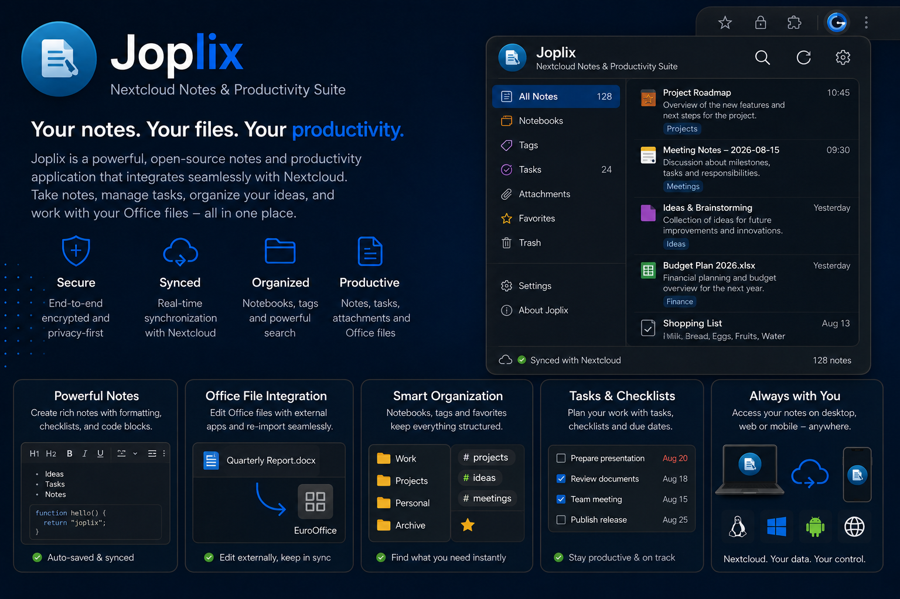

# Joplix Xsync
## Forked From: https://codeberg.org/Stoneubi/joplix

### Updated to include sync with a self hosted Joplin sync server.



Joplix is a modern, open-source notes and productivity application built for seamless Nextcloud integration. It lets you create, organize, edit, and synchronize your notes while keeping your data under your own control.  Joplix is currently the only tool that provides online access to Joplix, allowing you to access and work with your Joplix notes directly through a web browser.

Joplix is a modern, open-source notes and productivity application designed for users who want to keep their notes, documents, and data under their own control.

Built around Nextcloud, Joplix provides a central workspace for creating, editing, organizing, and synchronizing notes. Notes can be structured with notebooks and tags, while attachments and files can be integrated directly into your workflow. Office documents can also be opened and edited with external Office applications and then seamlessly returned to Joplix.

Joplix is especially useful for self-hosted environments where privacy, data ownership, and independence from commercial cloud platforms are important. Your data remains in your own Nextcloud environment while Joplix provides the interface and productivity features needed to work with it efficiently.

Synchronization keeps your Joplix workspace available across your devices and ensures that changes remain up to date.

A particularly important feature is online access: **Joplix is currently the only tool that provides online access to Joplix.** This means your Joplix environment is not limited to a locally installed application. You can access your notes and work with your Joplix data directly through a web browser from virtually any device.

## Synchronisation with Joplin Server

Joplix can synchronise its Nextcloud folder with a self-hosted [Joplin Server](https://github.com/laurent22/joplin/tree/dev/packages/server) account. Open **Settings › Synchronisation**, enter the server address, e-mail and password, test the connection and enable synchronisation.

- Joplin apps keep synchronising with the Joplin Server. Joplix exchanges changes with the same account in both directions.
- The Joplix folder in Nextcloud is at the same time a backup of the server content. With the Nextcloud *Versions* and *Deleted files* apps enabled, earlier versions of every note and remotely deleted notes stay recoverable.
- A Nextcloud background job keeps the folder current even when Joplix is not open. Background jobs should run via cron.
- End-to-end encryption must be disabled on the Joplin account.
- If the Joplin Server has a local or private address, a Nextcloud administrator has to switch on *Allow local server addresses* in the same settings tab.
- Do not let a Joplin app synchronise with the Joplix folder over WebDAV while this is enabled.

## Installation

Nextcloud administrators can update Joplix through its integrated updater and remove it from the Nextcloud Apps administration. Manual ZIP installations require access to the Nextcloud host. To remove the app while keeping user files, use Nextcloud Apps administration and avoid the separate legacy purge script.

### One-Step Installation

Joplix can be installed on your own server using the **Easy One-Step Installer**. Run the following command as root:

```bash
curl -fsSL https://raw.githubusercontent.com/kane9287/joplix-xsync/main/install/install.sh | sudo bash
```

The installer handles the required installation steps and provides a quick way to get your own Joplix instance up and running.

The installation files and further information are available in the [Joplix Xsync repository on GitHub](https://github.com/kane9287/joplix-xsync). See [install/README.md](install/README.md) for the beta channel, upgrades and removal.

Whether you use Joplix for personal notes, documentation, projects, research, checklists, or everyday organization, it combines the convenience of a modern notes application with the freedom of a self-hosted Nextcloud environment.

**Your notes. Your files. Your cloud. Your control.**

---

Please support this project: 
https://revolut.me/nuxnil

Created with ❤️ by Stoneubi from Austria / Tirol.

## Links

- [Website](https://github.com/kane9287/joplix-xsync)
- [Support](https://github.com/kane9287/joplix-xsync/issues)
- [Issue tracker](https://github.com/kane9287/joplix-xsync/issues)
- [Source code](https://github.com/kane9287/joplix-xsync)
- [Releases](https://github.com/kane9287/joplix-xsync/releases)
- [Original project (Stoneubi/joplix on Codeberg)](https://codeberg.org/Stoneubi/joplix)

## Donation

[Support Joplix](https://revolut.me/nuxnil)
